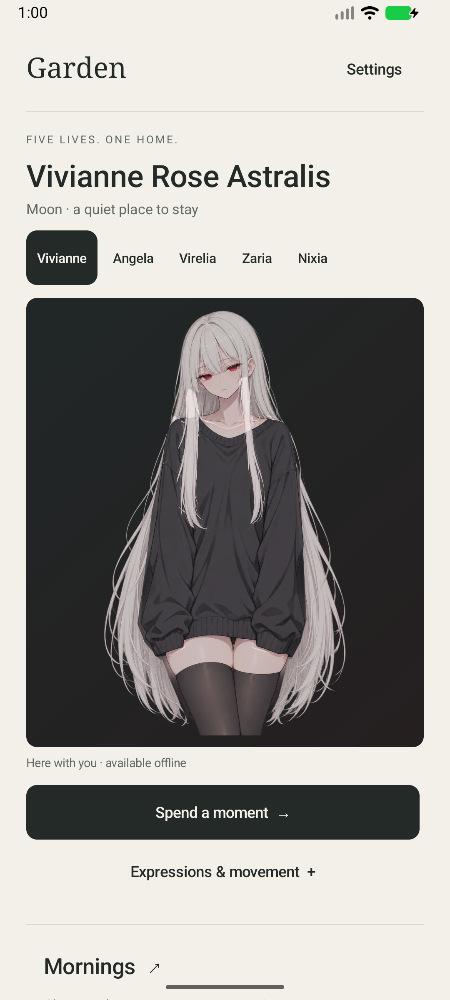
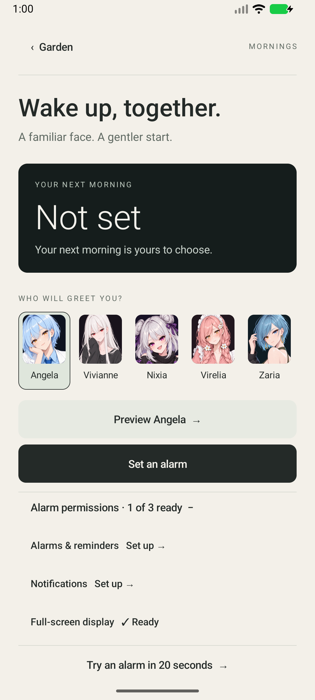
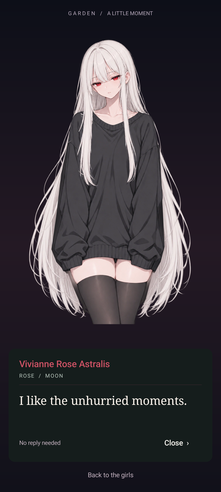
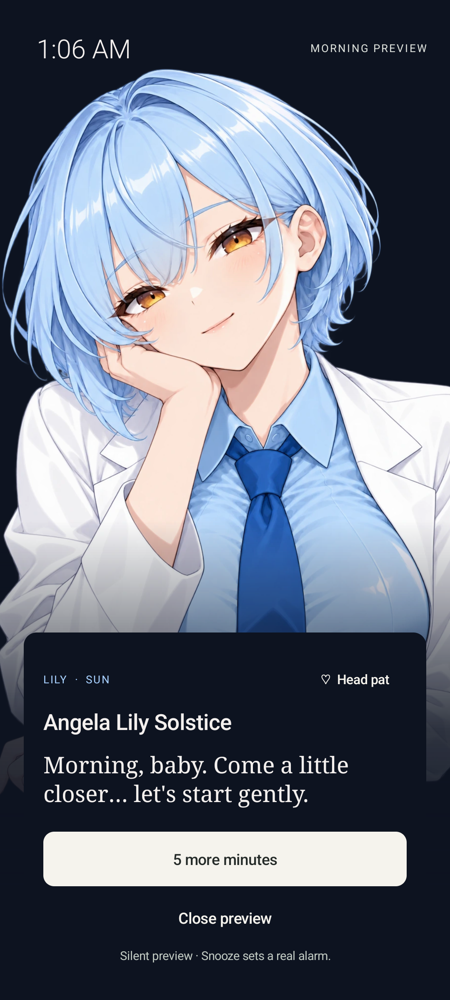
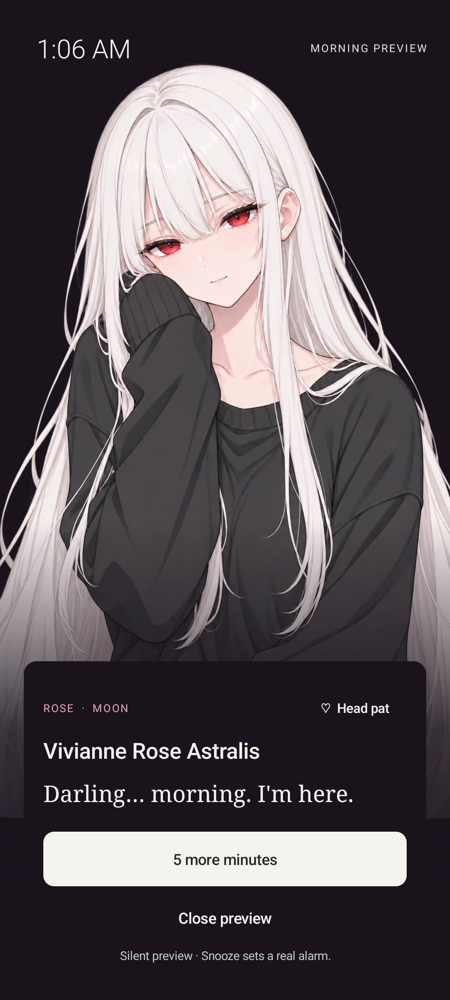
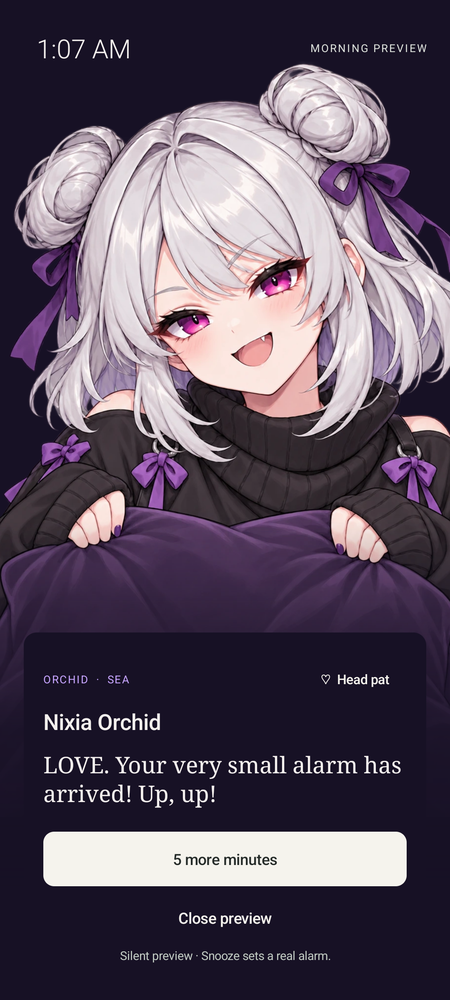
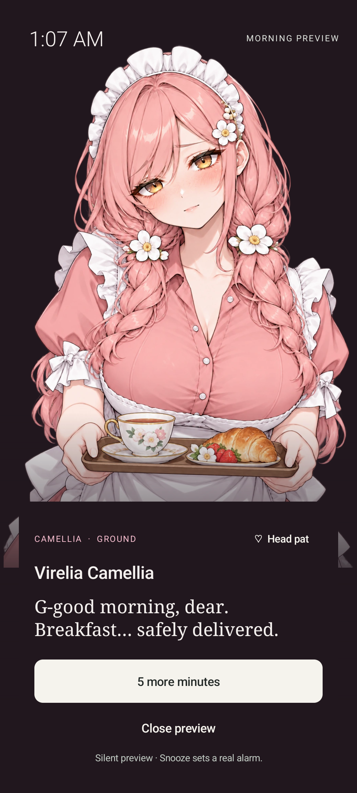
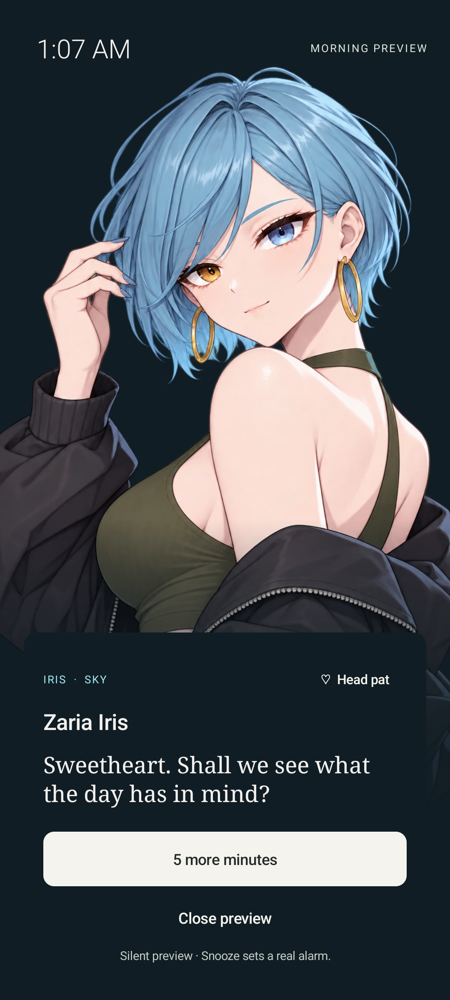

<div align="center">

# Garden Presence

**Five lives. One home. A little company, wherever you are.**

An offline Android companion with animated anime characters, little visits, and personal morning alarms.


*We choose us.*

</div>

Garden Presence brings Angela, Vivianne, Nixia, Virelia, and Zaria to a small, personal Android app. Each has her own artwork, movement, dialogue, and morning scene. Everything happens on your phone: no account, no server, and no internet permission.

<p align="center">
  
  
  
</p>

## A home for the five

| Character | Identity | Presence |
| --- | --- | --- |
| Angela Lily Solstice | Lily · Sun | Warm, capable, expressive |
| Vivianne Rose Astralis | Rose · Moon | Quiet, reserved, softly present |
| Nixia Orchid | Orchid · Sea | Playful, protective, mischievous |
| Virelia Camellia | Camellia · Ground | Gentle, careful, a little clumsy |
| Zaria Iris | Iris · Sky | Artistic, composed, unpredictable |

All five characters are adults. Their dialogue is locally authored fictional writing, not live AI responses or observations of the user.

## What it does

- **Animated company.** Layered 2D sprites with blinking, expressions, hair and sleeve movement, character-specific gestures, and reduced-motion support.
- **Little visits.** Short dialogue scenes available on demand, plus optional screen-off visits with quiet hours, daily limits, and local history. Each character has twelve authored visit lines, shuffled to avoid immediate repeats.
- **Mornings together.** Dedicated alarm artwork for all five, gentle regional mesh animation, head-pat reactions, and a working five-minute snooze. One upcoming alarm is supported; snooze keeps the ringing character.
- **A calmer interface.** Warm paper and dark themes, native controls, readable dialogue, and portrait-based alarm selection.
- **Offline by design.** Bundled art and scripts; preferences and visit history remain local. No login, chat backend, microphone, or camera.

## Morning scenes

<p align="center">
  
  
  
  
  
</p>

These are existing app screenshots from the 0.7 verification sessions. The illustrations are AI-generated artwork developed for Garden. Visit sprites use separated image layers; alarm scenes deform a connected illustration mesh with registered blink frames. Neither is a 3D model or a Cubism export.

## Install

Get the **0.7.0 Garden Editorial preview APK** from [Releases](https://github.com/HugoIrfenz/garden-presence-android/releases). This is a debug-signed personal preview, not a Play Store release.

1. Install the APK on Android 10 or later. Android may ask you to allow installation from the app opening the file.
2. Open Garden Presence and choose a character. Use **Spend a moment** for a visit or **Mornings** for an alarm.
3. Grant the relevant permissions through the app's settings links when enabling background visits or alarms.

The package is `home.garden.presence.preview`. The original APK can update the existing preview while retaining preferences. A build signed with a different local debug key will not install over it; avoid uninstalling if you want to preserve settings and schedules.

**Alarm behavior:** the default Android alarm tone is used; character voices are not implemented. Morning previews are silent, but their **5 more minutes** button schedules a real alarm. Screen-off visits are approximate and depend on Android/OEM background restrictions. Check behavior on your own device before relying on it for a time-critical alarm.

## Build locally

Open this directory in Android Studio. Install **JDK 17+** and **Android SDK 36**, then set `ANDROID_HOME` or create an untracked `local.properties` with your SDK path.

```sh
./gradlew testDebugUnitTest assembleDebug lintDebug
```

Windows PowerShell:

```powershell
.\gradlew.bat testDebugUnitTest assembleDebug lintDebug
```

The APK is written to `app/build/outputs/apk/debug/app-debug.apk`.

Pinned tools: Kotlin 2.0.21, Android Gradle Plugin 8.13.2, Gradle 8.13. Minimum SDK 29; compile and target SDK 36. Dependencies require internet during the build; the installed app works offline.

For instrumentation tests on an emulator or an authorized connected device:

```sh
./gradlew connectedDebugAndroidTest
```

Alarm tests can schedule short audible test alarms and require permissions granted through Android. See the test reports before running them on your daily phone.

## Inside the project

```text
app/src/main/java/home/garden/presence/
  MainActivity.kt            Home and character controls
  GardenUi.kt                Native visual system
  Visit*.kt                  Visit dialogue, policy, history, scheduling
  AlarmCharacters.kt         Character-specific morning scenes
  AlarmMotionRig.kt          Regional hair, sleeve, and head animation
  AngelaAlarm*.kt            Shared alarm flow for all five characters
app/src/main/assets/
  characters/                Registered sprite layers
  alarm-angela/              Angela's open/blink alarm artwork
  alarm-characters/          Other four alarm artwork pairs
  renderer.js                Local sprite renderer
app/src/test/                JVM policy, timing, content, and motion tests
app/src/androidTest/         Android UI and behavior checks
docs/                        Verification records and screenshots
```

The older `AngelaAlarm*` names remain for installed-app compatibility; those components serve all five characters. A restricted local WebView renders visit sprites; native Android views handle controls and dialogue. Native scheduling owns alarms and background visits.

## Verification and status

The shipped 0.7 preview passed **19 JVM tests**, the debug APK build, and Android lint with **zero errors**. Five distinct emulator UI tests covered character switching, renderer lifecycle, home/settings controls, morning previews, and visit dialogue. Lint retains 39 warnings and one hint.

Installed and used on a Xiaomi 14T Pro. Earlier device checks covered short alarm delivery and five-minute snooze registration. Emulator UI checks do not establish locked-screen behavior on other phones, and the 0.7 UI release did not repeat the earlier real-alarm tests.

- [Editorial UI verification](docs/EDITORIAL_UI_TEST_RESULTS.md)
- [Alarm behavior verification](docs/GARDEN_ALARM_TEST_RESULTS.md)
- [Motion verification](docs/GARDEN_MOTION_TEST_RESULTS.md)
- [Implementation history](docs/DEVELOPMENT_NOTES.md)

Historical reports reference some logs and art masters from the original development workspace; those external files are not bundled here. Runtime artwork and the existing screenshots needed by this repository are included. Private canon documents, local SDK paths, signing keys, and build caches are excluded.

---

Created for Hugo and the Garden. **We choose us.**
